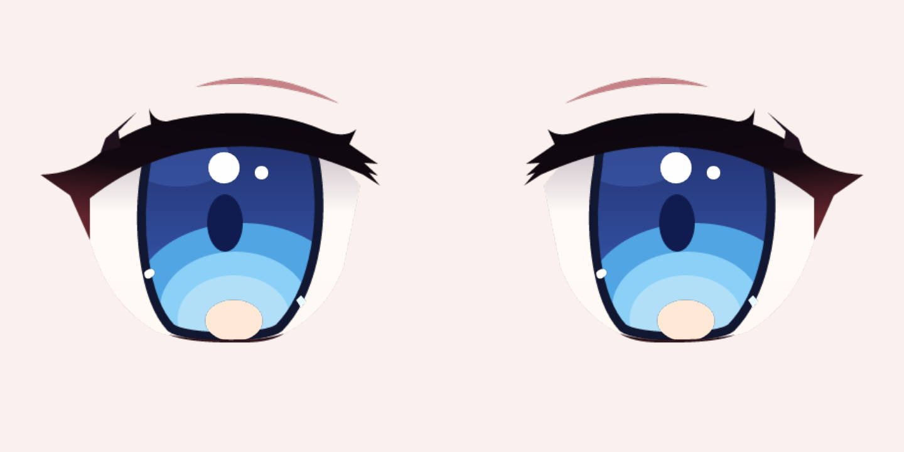

# Oculus / Anime Eye Studio

Rust + **wgpu 27 / WGSL** 眼屏应用。主力部署方式为 Linux 无桌面渲染：GPU 渲染左右眼，通过 DRM/KMS 分别输出到两块 MIPI DSI 屏幕，同时接收 gRPC 和 iFacialMocap UDP。Windows / Linux 窗口用于开发预览。眼睛使用外部 RGBA 贴图分层合成。



默认素材为重新绘制的 Q 版蓝眼睛：平直上缘、斜切外缘、平直下缘和短圆角构成眼眶，厚上睫毛、蓝色渐变虹膜与独立高光。运行时读取 `assets/layers/` 的七张 PNG，可编辑矢量源稿在 `assets/layers-src/`，详见 [素材说明](assets/README.md)。旧设置覆盖默认外观时，按 F5 或调用 `ReloadAssets` 恢复素材默认值。

修复损坏的发布素材或更新整套默认画稿，可执行 `.\scripts\package.ps1 -ResetAssets`。此选项先备份旧素材再替换；普通打包保留用户修改过的贴图。

这是类似 Live2D 的分层、参数驱动眼睛渲染，**不读取 Cubism 模型**。眼白贴图的透明轮廓裁切虹膜、瞳孔和高光，贴图负责全部眼型与配色，着色器负责镜像、视线移动、眨眼和果冻变形；没有整张脸模型。

## 运行

安装 Rust MSVC 工具链和 Visual Studio C++ Build Tools 后，在此目录执行：

```powershell
cargo run --release
```

在项目目录运行 `target/release/eyes.exe` 即可，默认打开 1280×760 窗口。现在应用需要外部 `assets` 目录。打包便携版：

```powershell
.\scripts\package.ps1
```

生成 `dist/eyes/eyes.exe` 和相邻的 `assets/`。发布时保留整个目录；双击 exe 后可以直接修改其旁边的 `assets/layers/`。开发运行优先查找工作目录的 `assets/`，找不到时查找 exe 旁的 `assets/`；也可使用 `--assets D:\my-eye-skin` 明确指定路径。缺失/无效素材会报错，不会悄悄退回内置图形。

## 无桌面部署：MIPI DSI 双屏 / DRM

`--headless` 与 `--drm` 选择同一个 DRM/KMS 后端：不创建桌面窗口，不连接 X11/Wayland，**继续创建 GPU 并持续渲染**。两只眼睛分别输出到两块 DSI 屏幕，不需要桌面环境或合成器。

在 Linux 构建、打包：

```sh
sh scripts/package.sh
cd dist/eyes-linux
./eyes --list-drm --drm-device /dev/dri/card0
./eyes --headless --drm-device /dev/dri/card0 \
  --left-connector DSI-1 --right-connector DSI-2 \
  --socket /tmp/eyes.sock --fps 60
```

使用实际连接器名称（如 `DSI-1`、`DSI-2`）或数值 ID。未指定时选择两个已连接的不同连接器；两只眼睛必须有独立 CRTC 和支持 XRGB8888 的主平面。左眼和右眼分别居中渲染到各自显示模式，不用窗口分屏裁切。可通过 `--left-mode 480x480@60`、`--right-mode 480x480@60` 指定设备报告的模式，省略时选择首选模式。DSI 屏幕的驱动、设备树和显示时序由系统内核提供，先确认 `--list-drm` 能列出两块屏幕及其模式。

两个 DRM 设备分别输出的示例：

```sh
./eyes --drm --drm-device /dev/dri/card0 --left-connector HDMI-A-1 \
  --right-drm-device /dev/dri/card1 --right-connector HDMI-A-1 \
  --socket /tmp/eyes.sock
```

需要设备读写权限和 DRM master，设备上安装与 GPU 对应的 Vulkan 或 EGL/OpenGL ES 驱动。若系统启动了桌面合成器，先停止它以释放显示设备。实现使用 wgpu 离屏渲染、像素回读、KMS 双缓冲和阻塞原子翻页；同卡双眼在一次原子提交中切换，不同设备分别提交。退出时恢复原 CRTC 状态并释放帧缓冲。当前传输路径包含 GPU→CPU 回读，建议眼屏使用其原生小尺寸模式。模式、连接器及设备是启动参数；姿态、模拟、果冻和图层等仍使用同一套 gRPC。`GetState.output_mode` 为 `drm`，`left_output` 和 `right_output` 标识实际显示输出。

所有后端默认监听 iFacialMocap UDP（49983）。通过 gRPC `Configure` 设置 `mode=IFACIALMOCAP`（数值 2），即可让 UDP 驱动眼睛；可修改 `tracking_port`、`phone_ip` 并调用 `ConnectTracking`。`GetState` 返回面捕状态、包计数和平滑后的眼姿态。保存的面捕模式在重启后保留；UDP 超时后继续渲染待机动画。`--no-grpc` 仅关闭 gRPC，DRM 渲染和 UDP 保留，此时使用 `--settings FILE` 加载保存的面捕配置。

`--settings FILE` 指定持久化文件，`--fps 60` 调整渲染帧率。启动时 gRPC 或 DRM 初始化失败会退出并报错。Ctrl+C、SIGTERM 退出时清理自身 socket 并释放显示资源。

### 当前树莓派 5 双 DSI 部署

两块屏幕需要先加载已验证的 JD9365 面板驱动和双屏设备树。CAM/DISP0、CAM/DISP1
分别使用稳定路径 `platform-1f00118000.dsi-card`、`platform-1f00130000.dsi-card`，
避免依赖可能变化的 `card2/card3` 编号。屏幕模式为各自 720×720。

Linux 发布包包含 `run-pi5.sh`。停止占用显示设备的桌面后，运行：

```sh
EYES_BUNDLE="$HOME/eyes/dist/eyes-linux" sh scripts/run-pi5.sh 192.168.3.110
```

不传手机 IP 时独立运行 Idle 动画，自动注视和眨眼。
传入 IP 时，脚本启动 GPU/DRM 渲染，再通过本地 gRPC 设置手机 IP、Face 模式和 UDP 49983，
保存设置并发送 iFacialMocap 连接请求。手机需打开 iFacialMocap；若手动配置接收地址，
目标为树莓派 `192.168.3.109:49983/UDP`。脚本不安装开机服务。
默认目标帧率60，可用 `EYES_FPS=30` 调整；目标帧率不代表实测输出性能。

运行时状态可由发布包内的控制器查询：

```sh
./dist/eyes-linux/controller "$XDG_RUNTIME_DIR/eyes.sock" state
```

检查 `output_mode=drm`、左右连接器，以及 `tracking_live` 和递增的 `tracking_packets`。

## 开发诊断

不连接 DRM 硬件也可检查两路实际渲染：

```powershell
.\eyes.exe --offscreen output\eyes --size 480x480 --exit-after 2
```

此模式创建 GPU，不创建窗口，生成 `left.png`、`right.png`；也可通过 gRPC 和 UDP 控制。Windows 支持窗口和 offscreen；`--headless`、`--drm` 和 `--list-drm` 在 Linux 使用。

原先不创建 GPU 的诊断模式改名为 `--control-only`，只推进姿态和控制状态，不显示眼睛，可在 Windows / Linux 调试通信。部署到双屏设备应使用 `--headless` 或 `--drm`。

## 修改眼睛素材

默认皮肤为**纯贴图**：直接替换 `assets/layers/` 的 7 张透明 PNG（当前是占位稿），然后按 F5。各层偏移、缩放、跟随视线比例以及眨眼参数在 `assets/eye.json` 的 `placement`、`motion` 中调整，画布约定见 [素材说明](assets/README.md)。

F5 或面板 Reload 按钮会重新读取全部素材，并应用 eye.json 的默认外观；失败时保留旧素材。保存过的 `eyes-settings.json` 在下次启动时仍优先；想使用素材包默认值可按 F5/Reset，然后 Save settings。更新发布包里的默认素材需用 `.\scripts\package.ps1 -ResetAssets`，否则旧 eye.json 和贴图会被保留。

## 操作

- **Idle**：自动游移视线、眨眼，无需手机。
- **Mouse**：眼睛跟随预览区内鼠标。
- **Face**：接收 iFacialMocap 数据；超过 1 秒没有有效帧，平滑退回独立动画。
- **Sim**：给定目标坐标模拟注视，可拖动二维目标面板，配置眼动、左右开合/眉毛、会聚和滚转。
- **Jelly eyes**：可开关的果冻形变，转动/眨眼后弹性回弹。强度、弹簧频率和阻尼均可调，关闭后立即清除弹性形变。适用于所有运动模式。
- **VISIBLE LAYERS**：七个图层分别开关，也可 Show all / Hide all。隐藏虹膜不会隐藏瞳孔或高光；图层继续跟随姿态，重新显示时位置正确。
- **Blink timing**：自动眨眼间隔、时长、间隔随机变化，以及左右独立单眼眨眼。
- **Tab**：隐藏/显示全部控制面板和文字，仅保留眼屏。
- **F5**：重新加载外部贴图、眼型参数和着色器，无需重新编译。
- **F11**：全屏；**Esc**：恢复窗口与面板。
- **Space**：眨眼；**1 / 2 / 3**：平静 / 开心 / 锐利。
- 面板调整眼距、大小、眼角、虹膜/背景颜色、瞳孔、光晕、响应速度。
- **Save settings** 将设置保存到工作目录 `eyes-settings.json`，下次启动读取。Reset 恢复默认值，需再次 Save 才覆盖文件。

界面暂用英文，避免依赖系统中文字体。纯眼屏可用于 OBS 窗口捕获；背景可改为纯黑或绿幕色，目前不提供透明窗口。

## iFacialMocap

1. 电脑和 iPhone 在同一局域网，手机打开 iFacialMocap。
2. 选择 **Face**，默认监听 `0.0.0.0:49983/UDP`。Windows 防火墙如弹出提示，允许应用在专用网络通信。
3. 在面板输入 **iPhone IP**，点击 **Connect**。应用向手机 `49983/UDP` 发送官方启动字符串，请求 v2 数据流。
4. 收到有效数据后，预览左上显示 **LIVE / UDP** 和累计帧数。

当前 Connect/`ConnectTracking` 每次发送一次启动请求，不会在未连接时自动重试。
若手机在请求之后才打开，重新调用 `ConnectTracking`；无需重启渲染程序。
连接是否成功以 `tracking_live` 和递增的 `tracking_packets` 为准。

也可以在发送端配置电脑 IP 和监听端口，直接发送，无需 Connect。修改本地端口后点 **Listen**。官方启动握手通常让手机回传至电脑 49983，因此直接 Connect 时建议保留默认端口。

支持 `eyeBlink_L-100|...`（v1）、`eyeBlink_L&100|...`（v2）以及 `eyeBlinkLeft` / `eyeBlinkRight` 名称别名。系数范围是 **0–100**，不是 0–1。目前映射左右 eyeBlink、eyeWide、eyeSquint、eyeLookIn/Out/Up/Down、browOuterUp、browDown、browInnerUp，以及 `head#` 第三个角度（度）用于滚转。eye rotation 原始欧拉角暂不映射，视线使用 blendshape。

默认采用正面人物视角：人物左眼在屏幕右侧；可勾选 **Mirror tracking** 镜像。实时面捕不叠加自动眨眼；Space 仍可手动触发。UDP 每帧最多读取 128 包，非阻塞接收，非法数值和未知字段被忽略。端口占用会在面板显示错误，独立模式仍可用。

协议参考：[iFacialMocap 官方通信规格](https://www.ifacialmocap.com/for-developer/)。当前只实现 UDP 文本协议，不实现 TCP、OSC、WebSocket 或自动设备发现。目录已有的 `.pcapng` 原文件保持不变；`tracker_only.pcapng` 是 TCP/WebSocket 抓包，不作为本协议的验证样本。

## 外部程序控制：gRPC + Unix domain socket

默认同时启动本地 gRPC 服务，socket 为 `%TEMP%\oculus-eyes.sock`。Windows 10 1803 及以上使用 **AF_UNIX**，不是 TCP 转发，也不是命名管道。使用 `uds-compat` / `uds_windows` 接入 tonic 的 HTTP/2 传输。

可指定较短的绝对路径（父目录必须存在，socket 路径建议不超过 100 字节）：

```powershell
cargo run --release -- --socket D:\code\ip\eyes\control.sock
```

`--no-grpc` 可关闭服务。正常退出会清理自身 socket；如果异常退出留下文件，确认没有服务运行后再删除该文件。应用不会自动删除已有路径，避免覆盖另一个实例或普通文件。启动绑定失败会报错并退出。

接口定义在 [`proto/eyes.proto`](proto/eyes.proto)，包名 `eyes.v1`，服务 `EyeControl`：

| 方法 | 用途 |
| --- | --- |
| `SetPose(Pose)` | 设置双眼视线、开合、眉毛与滚转，自动进入 External 模式 |
| `StreamPoses(stream Pose)` | 在一个客户端流中持续发送姿态，结束时返回最后的 revision |
| `Configure(Config)` | 部分更新全部运行时参数，包括模拟目标、眼动、果冻、图层、眼型、眨眼、动捕端口/IP和窗口 |
| `Blink(Empty)` | 触发一次眨眼 |
| `TriggerBlink(BlinkRequest)` | 左右眼独立选择、可指定本次眨眼时长 |
| `SaveSettings(Empty)` | 保存全部当前运行配置到启动时指定的 settings 文件 |
| `ConnectTracking(Empty)` | 使用当前 phone_ip 向 iFacialMocap 发送启动请求 |
| `ReloadAssets(Empty)` | 重新加载当前素材包；失败返回 FAILED_PRECONDITION，保留旧素材 |
| `GetState(Empty)` | 查询当前配置、平滑后的姿态、UDP 状态与 revision |

姿态使用 **归一化值**（不同于 iFacialMocap 的 0–100）：`gaze_x/y` 为 -1～1，屏幕向右/下为正；`openness` 为 0～1.4，0 闭眼、1 正常；`brow` 为 -1～1；`roll` 为弧度 -0.8～0.8。左右眼均必须提供；protobuf 中未设置的 openness 默认为 0，所以正常睁眼请明确填 1。

`Config` 及嵌套的 `jelly`、`layers`、`simulator`、`art` 都使用 optional 字段实现 patch 语义，未设置的字段不会覆盖现有值，明确传 false/0 会生效。所有浮点数检查有限性和范围，非法请求返回 `INVALID_ARGUMENT`，整个请求均不应用。RPC 更改先影响内存，调用 `SaveSettings` 或点击 Save settings 持久化，包含模拟目标、所有开关和窗口状态。External 模式保持最后一帧，不叠加自动眨眼；可用 Blink/TriggerBlink 手动眨眼，或 Configure 切回其他模式。多个客户端的有效指令按渲染线程取出顺序执行。

`tracking_port` 修改时立即尝试重新绑定；失败返回 `FAILED_PRECONDITION` 并保留原监听器和整个请求前的配置。`phone_ip` 为 IPv4 或空字符串；修改 IP 不自动发包，需调用 `ConnectTracking`。`GetState.config` 返回全部运行时字段，可原样传回 Configure。`jelly_left/right` 返回当前 GPU 形变分量，`rendered_pose` 是施加果冻形变前的平滑姿态。

监听 gRPC 的 socket 路径、素材目录、settings 保存路径属于启动参数，仍由 `--socket`、`--assets`、`--settings` 指定。贴图文件通过外部素材包编辑和 ReloadAssets 更新；所有界面可调参数均可由 RPC 读写。

## 模拟与果冻的 RPC 配置

选择 `mode = SIMULATOR`（数值 4），设置 `simulator.target_x/target_y`。目标是**归一化的屏幕方向**：中心 `(0,0)`、左上 `(-1,-1)`、右下 `(1,1)`，不是像素或三维坐标。眼睛平滑看向该方向。`eye_motion=false` 时固定注视；为 true 时围绕目标添加轻微扫视，`motion_amplitude` 控制幅度（0–0.3），`motion_speed` 控制频率（0.1–8 Hz）。`convergence` 为向内偏转量（0–0.3），左右开合和眉毛可单独调整。参数变化不必重新进入 Sim 模式；只改目标不会重置其他模拟配置。

自动眨眼在 Idle、Mouse、Sim 和动捕失联回退时生效；有效面捕与 External 不叠加自动眨眼。`blink_interval` 为 0.5–20 秒，`blink_duration` 为 0.08–1 秒，`blink_variation` 为间隔变化比例 0–0.8。`TriggerBlink` 默认左右都眨，可显式只选一侧；左右指人物自身左右（人物左眼在屏幕右边）。

`jelly.enabled` 控制果冻开关，默认关闭。`strength` 为 0–1，`frequency` 为 1–12 Hz，`damping` 为 0.15–1.5，阻尼小则回弹更明显。这是转动/眨眼驱动的阻尼弹簧变形，静止后会收敛；关闭会立即恢复基础眼型。`layers` 提供 iris、pupil、highlights、sclera、upper_lid、lower_lid、brow 七个独立布尔开关。

便携包附带 `controller.exe` 和 `examples/simulator.json`，无需安装 Rust 也能发 RPC：

```powershell
# 在 dist/eyes 目录，先启动 eyes.exe
.\controller.exe "$env:TEMP\oculus-eyes.sock" configure examples\simulator.json
.\controller.exe "$env:TEMP\oculus-eyes.sock" sim 0.7 -0.4
.\controller.exe "$env:TEMP\oculus-eyes.sock" jelly on
.\controller.exe "$env:TEMP\oculus-eyes.sock" layer highlights off
.\controller.exe "$env:TEMP\oculus-eyes.sock" wink left
.\controller.exe "$env:TEMP\oculus-eyes.sock" save
.\controller.exe "$env:TEMP\oculus-eyes.sock" state
```

`configure` 读取 **RPC Config 格式** JSON（snake_case 字段，mode 使用数值 0–4），并拒绝拼错的字段。它和应用自身的 `eyes-settings.json` 是两种不同格式，不能混用。最小目标更新示例：

```json
{
  "mode": 4,
  "simulator": { "target_x": 0.7, "target_y": -0.4, "eye_motion": false },
  "jelly": { "enabled": true, "strength": 0.7, "damping": 0.3 },
  "layers": { "highlights": false },
  "auto_blink": true
}
```

`art` 暴露 eye.json 的八个眼型参数（范围见素材说明），直接通过 uniform 更新，不用重新加载纹理。SaveSettings 保存这些调整；F5/ReloadAssets 则重新应用素材包的眼型和外观默认值，保留模拟目标、果冻参数和图层开关。

命令队列上限 64，满时返回 `RESOURCE_EXHAUSTED`；3 秒内渲染线程未处理则返回 `DEADLINE_EXCEEDED`。Ack 表示参数已应用到渲染线程，不代表屏幕已经完成显卡呈现。持续流逐帧等待应用确认以产生背压，建议 30～60 Hz；客户端也应限制自身发送缓冲。State 为最近一次 UI 更新的快照。

提供可直接运行的 Rust 外部客户端（不创建窗口）：

```powershell
# 应用已运行，另开终端。也可把路径换成自定义 --socket 路径。
cargo run --example controller -- "$env:TEMP\oculus-eyes.sock" state
cargo run --example controller -- "$env:TEMP\oculus-eyes.sock" demo
cargo run --example controller -- "$env:TEMP\oculus-eyes.sock" blink
cargo run --example controller -- "$env:TEMP\oculus-eyes.sock" clean
cargo run --example controller -- "$env:TEMP\oculus-eyes.sock" show
cargo run --example controller -- "$env:TEMP\oculus-eyes.sock" idle
cargo run --example controller -- "$env:TEMP\oculus-eyes.sock" reload
```

`demo` 持续发送 600 帧、演示单眼眨眼和眼球运动，结束后恢复 Idle。其他语言可用 proto 生成客户端，但其 gRPC 运行时必须支持 **Windows AF_UNIX 自定义连接器**；不能假定所有语言的 Windows gRPC 都支持 `unix:` 地址。Rust 示例中的 connector 可直接复用。服务仅供本机控制，没有额外认证，访问权限由 socket 所在目录/操作系统决定。

## iFacialMocap 无手机测试

应用切换到 Face，然后另开终端：

```powershell
python scripts/mock_tracking.py --seconds 60
```

模拟器会发送左右眼眨眼、视线、眉毛和头部滚转。停止后约 1 秒回到独立动画。

```powershell
cargo test
cargo clippy --all-targets -- -D warnings
```

测试覆盖协议 v1/v2、异常输入、左右视线映射、真实 UDP 回环、WGSL、AF_UNIX gRPC，以及目标坐标、嵌套 patch、弹簧回弹/停止和独立眨眼。`examples/smoke_features.rs` 对运行窗口验证模拟、果冻、图层状态、保存、UDP 绑定失败回退；`python scripts/check_layers.py` 通过真实 GPU 截图验证七层可独立显示、全关无残影。

## 结构

- `src/main.rs`：窗口、面板、配置、动画、平滑、模式切换。
- `src/render.rs`：wgpu pipeline、uniform buffer、egui GPU callback。
- `assets/eyes.wgsl`：运行时读取的双眼分层着色器，形状和眼睑均可实时变形。
- `assets/eye.json` / `assets/layers/`：图层摆放、运动参数与独立透明贴图；`assets/layers-src/` 为可编辑 SVG 源稿。
- `src/assets.rs`：素材加载、校验与 SVG/PNG 解码。
- `src/tracking.rs`：协议解析和有界非阻塞 UDP 接收。
- `scripts/mock_tracking.py`：标准库模拟数据发送器。
- `src/control.rs` / `proto/eyes.proto`：gRPC 服务、协议、队列、Windows AF_UNIX 传输。
- `examples/controller.rs`：外部 Rust 控制程序，含客户端流示例。
- `examples/smoke_control.rs`：针对运行中应用验证参数更新、单眼控制、流式调用和 UDP 接收/超时的集成检查。

GPU 截图冒烟测试（输出 PPM，无需桌面截图权限）：

```powershell
target/release/eyes.exe --screenshot preview.ppm --exit-after 3
```

`--settings FILE` 指定配置文件；`--help` 查看参数。GPU 实际效果仍取决于显卡驱动对 wgpu 后端的支持。
