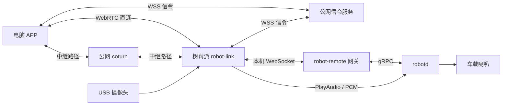

# 公网遥控实施计划

当前实现使用 Rust 的 `robot-wan-signal` 和 `robot-link`。下文记录最初的协议和验收设计。运行参数、已实现的消息格式、媒体编解码器和切换顺序见 [公网遥控 API v1](../robot_wan/API.md)。

电脑 APP 与树莓派建立一条 WebRTC PeerConnection，同时承载遥控数据、电脑到车载喇叭的按键喊话，以及车载摄像头到电脑的实时视频。ICE 优先选择可用的直连路径，直连不通时使用 TURN。首期按一辆车、一位远程操作员、一台摄像头设计。操作员可先看视频，再决定是否取得驾驶权。



## 部署

| 位置 | 进程 | 职责 |
| --- | --- | --- |
| 公网服务器 | 信令服务 | 通过 HTTPS/WSS 验证车辆和操作员，列出获准访问的车辆及其在线状态，转交 SDP 和 ICE 候选，签发短期 TURN 凭据 |
| 同一台服务器 | coturn | 提供 STUN 与 TURN，开放配置好的监听端口及中继端口范围。首轮覆盖 UDP 和 TURN/TLS；在限制网络实测可达性 |
| 树莓派 | 新增 robot-link.service | 主动连接信令服务，建立 WebRTC 会话，为每个获准的电脑会话打开一条本地 robot-remote WebSocket，转换消息并上报所选路径与 RTT |
| 树莓派 | 现有 robot-remote、robotd | 网关继续处理动作、标定、手柄绑定与状态。robotd 在本机仲裁租约、校验关节限位、调度动作并控制硬件 |

公网入口使用域名和受信证书。单车交付先预置独立的车辆凭据和操作员凭据，在信令端记录允许访问的车辆。授权成功后才能交换该车会话的 SDP 和 TURN 临时凭据。公网服务只保存配对关系；动作库、关节标定和设备反馈仍取自车上。robotd 的 50051 和现有网页 8080 均无需公网端口映射。

车端首选扩展现有 Python 网关环境，新增独立 systemd 单元，先在 Pi ARM64 验证 WebRTC 依赖可安装并与 APP 使用的协议栈互通。公网不可达时，车端后台重连；本地网页、蓝牙手柄和眼屏照常启动。交付热点占用 wlan0 时，公网需要另外的出口，例如以太网、USB 网络共享或蜂窝网络。

## 与 APP 团队约定的接口

| 通道 | 内容 | 交付约定 |
| --- | --- | --- |
| WSS 信令 | 上线、授权车辆列表、建立或关闭会话、offer/answer、ICE candidate | APP 发起 offer，车辆应答。会话 ID 随重连重建。同一会话从直连到中继沿用相同业务协议 |
| 可靠有序数据通道 | 获取状态、接管、释放、急停、动作预设与序列、眼屏参数、配置和手柄绑定 | 复用现有网关命令名与 JSON 字段；请求 ID 对应结果或错误；保留 revision 冲突、控制权占用、关节越界等错误。动作超时后先查状态 |
| 实时驾驶数据通道 | 底盘速度和转向 | 无序、零重传。绑定当前控制会话，携带递增序号和车端签发的短时有效时间标记。车端只接受更新且仍有效的目标，只保留最新一帧 |
| 状态通道 | 最新设备快照、控制者、当前动作、故障和链路状态 | 初值按现有网关 10 Hz；积压时丢弃旧快照。分别报告信令在线、端到端连通、robotd 可用、设备反馈和控制权 |

### v1 会话和通道

信令服务建议用 Python/aiohttp，复用车端团队已有工具链。单实例用 SQLite 保存车辆、凭据摘要及操作员到车辆的授权关系；在线连接和临时会话放在内存。车端以 systemd 环境文件读取自己的公网凭据、网关凭据和 robotd 本机凭据。APP 只持有操作员凭据。撤销配对时通知两端关闭现存会话，同时停止签发新的 TURN 凭据。

两端通过 `wss://域名/v1/signal` 建立出站连接，在握手中使用 Bearer 凭据。车辆上线发送 `robot.hello`，携带车辆 ID、协议版本及可用摄像头/音频能力。APP 用 `robots.list` 获取已授权车辆，再发 `session.open`。服务端核对双方身份与在线状态，向两端返回同一 `sid`、车端能力和带有效期的 `ice_servers`。同车已有远程会话时返回 `BUSY`。登录、观察或打开摄像头均不取得运动租约。

APP 创建下表通道并发 offer，音频方向从 APP 看为 `sendonly`，视频为 `recvonly`；Pi 返回 answer。能力缺失时允许相应媒体段 inactive。双方以 `sid` 转交 SDP 和 ICE 候选，支持附在 SDP 中的完整候选，也支持增量候选及结束标志。ICE/DTLS 就绪、通道打开后方可调用业务命令。信令重连与运动续租独立；若需重建 PeerConnection，分配新 `sid`，重新显式接管。会话关闭、撤销或信令失联超过 10 秒，车端结束该会话。

| 标识 | 传输 | 行为 |
| --- | --- | --- |
| `rpc.v1` | 可靠有序 DataChannel | 配置、动作、接管、释放、喊话开关。复用网关的 `id/method/params` 与 `result/error`；写入带原 revision |
| `drive.v1` | 无序 DataChannel，`maxRetransmits=0` | 仅传连续底盘目标。每帧包含本次接管的 `epoch`、递增 `seq`、车端时间标记 `tick` 和 `chassis` |
| `state.v1` | 无序 DataChannel，`maxRetransmits=0` | Pi 每 100 ms 推最新状态、状态序号、`tick`、视频与喊话状态。接收端丢弃倒序快照 |
| `stop.v1` | 独立可靠 DataChannel | 仅接受锁定急停；车端使用独立本地请求调用 `Stop(latch=true)`，绕开正在等待响应的普通控制请求 |
| microphone / camera | WebRTC 音频 / 视频轨 | 音频 Opus，视频协商 H.264 或 VP8。媒体使用 SRTP；直连与中继共用同一协议 |

最小交互样例（每行一条消息）：

```jsonl
{"type":"session.open","id":"s1","robot_id":"car-01","version":1}
{"type":"offer","sid":"session-8","sdp":"<SDP>"}
{"id":1,"method":"acquire","params":{"ttl_ms":1000,"clear_latch":false,"tick":483300}}
{"type":"reply","id":1,"result":{"epoch":"drive-4","ttl_ms":1000}}
{"seq":91,"tick":483400,"state":{"owner":"remote/operator-01"}}
{"epoch":"drive-4","seq":1,"tick":483400,"chassis":{"mode":"ACKERMANN","speed_m_s":0.1,"steering_rad":0.0,"yaw_rate_rad_s":0.0}}
{"id":2,"method":"talk.begin","params":{}}
{"id":3,"method":"talk.end","params":{}}
{"id":4,"method":"stop","params":{"latch":true}}
```

车端根据已认证的操作员填写 owner，本地会话 ID 和租约 token 留在车上。APP 直接回显最新状态的车端单调毫秒数 `tick`。车端检查该标记确实由本会话发出，在转发驾驶帧时计算 `ttl_ms = min(200, 300 − 标记年龄(ms))`，不足 100 ms 则丢弃。每次重新接管更换 epoch，重置序号。普通 RPC 的 targets 禁止携带 chassis，连续驾驶只有一个入口。续租和可触发运动的离散请求也带当前 epoch 和最近 tick，车端拒绝超过 500 ms 的请求；接管请求带最近 tick，锁定急停不设新鲜度门槛。RPC 超时后动作执行结果未知，应查询状态，禁止自动重发。样例中的状态省略设备快照和媒体字段。

**公网延迟预算。** 车端发出时间标记到转发目标的总预算取 300 ms；其中至少留 100 ms 给 robotd。直连或中继下允许的标记年龄都是 200 ms，包含网络往返和等待下一次状态推送的时间。下发时最多给底盘 200 ms。每路最多一个尚未完成的底盘 RPC，等待期间只覆盖最新帧，真正转发时再算有效期。仪表应区分“已连通”和“驾驶帧过期”；弱网仍可看视频、喊话和查状态。联调记录实际接收率及停车间隔，再决定是否调整有效期。加大目标有效期也会延长断链后的运动时间。

### 喊话

首期做单向按键喊话。车端收到 `talk.begin` 后为该远程会话建立一个本地 `PlayAudio` 流，首包发送 48 kHz 单声道 header。只在喊话开启期间把当前音轨解码、重采样成 PCM16LE，以 20 ms（960 样本、1920 字节）为一块发送。Opus 走 RTP，建议以 20 ms、24～40 kbit/s 作为语音起点。APP 等到车端返回已受理再开放麦克风。音频进程的忙碌、播放失败和实际起播阶段通过状态通道反馈。音频使用独立异步任务，声卡背压不能阻塞续租和急停。[robotd 播放接口](../robotd/docs/audio.md) · [Opus RTP](https://www.rfc-editor.org/rfc/rfc7587)

松开按键发送 `talk.end` 并静音，Pi 半关闭输入，让已入队的短句尾音播完。媒体断开、会话撤销或急停则立即取消本会话自己的播放流并丢弃余音。使用单槽喊话状态避免重复 begin；车载 TTS 已占用播放器时返回 `AUDIO_BUSY`，不抢占 TTS。Pi 入口只保留约 60 ms 的解码音频；持续背压时丢最旧块，避免把实时讲话变成延迟播报。robotd 现有配置还有约 100 ms 起播预缓冲及 ALSA 缓冲，验收要测麦克风到喇叭的总时间。

### 视频

双眼已占用 Pi 5 的两个 CAM/DISP 端口，默认接一台 **USB UVC 摄像头**。用稳定的 `/dev/v4l/by-id/` 路径配置，在车上枚举支持的格式与帧率。首版只在远程会话订阅视频时打开摄像头，会话结束释放。摄像头拔除后上报 `CAMERA_OFFLINE` 并重试打开；连接、遥测和喊话可继续。[树莓派相机文档](https://www.raspberrypi.com/documentation/computers/camera_software.html)

车端初选 aiortc + PyAV/V4L2。从 640×480、15 fps 起测，目标档 720p、15 fps、约 1～2 Mbit/s。优先协商 H.264 Constrained Baseline，互通失败选 VP8。首版按可解码采集帧再编码估算 CPU；相机自带 H.264 的免重编码路径须单独验证 profile、关键帧和 RTP 打包。采集/编码与控制任务分开运行，采集队列仅保留最新一帧。记录采集帧率、发送帧率、RTT、丢包和码率；拥塞或双眼掉帧时先降视频帧率、分辨率或暂停视频。横屏画面冻结必须显式提示最后新帧时间。[aiortc 接口](https://aiortc.readthedocs.io/en/latest/api.html) · [WebRTC 视频编码要求](https://www.rfc-editor.org/rfc/rfc7742)

### 公网部署与容量

信令占 TCP 443；coturn 提供 STUN/TURN UDP 3478、TURN/TLS TCP 5349 和一段明确放通的 UDP relay 端口（单车示例 49160～49200）。若交付网络只放 TCP 443，为 TURN/TLS 配独立公网 IP 的 443 监听；相同 IP 上两个域名仍共享端口。服务器位于 NAT 后面时配置外部映射地址。信令服务与 coturn 共用服务端签发密钥，向已获准的两端下发限时凭据，重建连接时获取新凭据。首期使用一台接近车辆运营区域的 VPS，直连和 TURN 都验证后交付。[coturn 配置样例](https://github.com/coturn/coturn/blob/master/examples/etc/turnserver.conf) · [ICE 选路](https://www.rfc-editor.org/rfc/rfc8445)

每车 2 Mbit/s 视频持续一小时约 0.9 GB 视频净荷。直连时这部分流量走车载上行；中继时服务器另有约 0.9 GB 入站和 0.9 GB 出站，协议开销、重传及音频另计。公网服务记录路径类型、会话时长和各方向字节数，便于按实际 relay 比例估费。

## 控制权与断线

1. 连接后默认观察，由操作者显式接管。电脑、网页和蓝牙手柄共用 robotd 的独占租约。通过授权的控制端可在未持有租约时发锁定急停。解锁须独立、显式操作。
2. 沿用当前参数作为首轮联调基线：底盘目标 200 ms、驾驶更新 20 Hz、租约 1 s。只有 APP 的新鲜续租能延长远程控制权。车端使用自己的单调时钟校验回显时间标记，并把剩余有效期传给 robotd；低于 robotd 接受的 100 ms 下限即丢弃。无须假设车和电脑时钟同步。
3. 急停越过普通业务排队发给本地网关。驾驶链路中断后即使急停包无法送达，底盘也由本机目标超时停止速度输出。关闭远程会话时关闭其专属本地 WebSocket 并释放租约；进程失联时由 robotd 租约到期停止并取消动作。重建会话后清空目标并重新接管。
4. 车端确认分为“命令已受理”和“设备反馈”。记录选中路径、RTT、丢弃的过期驾驶帧和最后有效反馈时间，便于区分网络故障、robotd 故障和舵机离线。

## 阶段与验收

| 阶段 | 交付物 | 验收条件 |
| --- | --- | --- |
| 1　协议冻结 | 信令和数据通道约定、单位、错误、会话时序、样例报文及命令行联调工具 | APP 团队能独立对接模拟车，覆盖查询、占用拒绝、执行一个动作、停止和重连 |
| 2　强制中继 | 公网信令与 coturn 配置、Pi 端 robot-link 服务 | 两端在不同网络，禁用直连仍可查询和控制模拟车；未配对端无法建会话；日志确认走 relay |
| 3　P2P 与故障测试 | ICE 自动选路、路径显示、时延与丢包采样 | 验证同 LAN、异地可直连、运营商 NAT、限制 UDP；断网、切网及延迟包注入后无旧目标重放，手柄与 APP 互斥 |
| 4　音视频联调 | UVC 采集、WebRTC 媒体协商、Opus 到 PlayAudio 适配 | 直连和强制中继各测一轮；运行双眼 DRM 并持续发送驾驶帧，用同框计时器测镜头到屏幕时延，用同一录音设备测麦克风到喇叭时延，记录 P50/P95、丢帧及超时停车次数。首轮目标为稳定网络视频 P95 ≤ 350 ms、喊话 P95 ≤ 350 ms；相机拔插、声卡被占、上行限速时，遥测和急停仍可用 |
| 5　实车交付 | systemd、配对与撤销流程、运行手册和版本化接口文档 | 冷启动后无公网也能本地使用；恢复互联网后电脑可重新接管；限速实测松杆和断网，从最后有效目标到停车指令、实际车轮停止分别记录 |

参考 [现有遥控网关](README.md)、[robotd 接口](../robotd/proto/robot.proto)、[热点与上行网络](../robotd/deploy/network/README.md)、[WebRTC Data Channels](https://www.rfc-editor.org/info/rfc8831/) 和 [coturn](https://github.com/coturn/coturn)。
